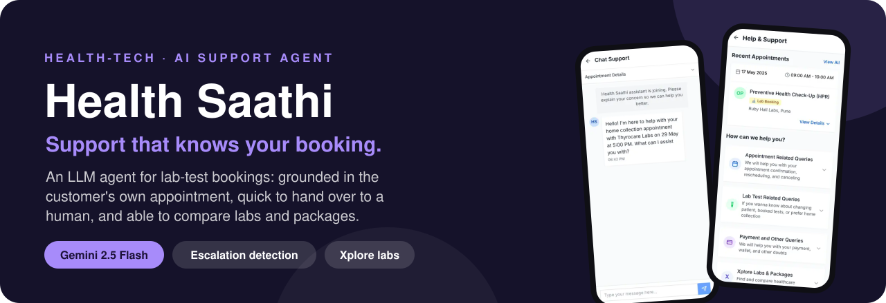
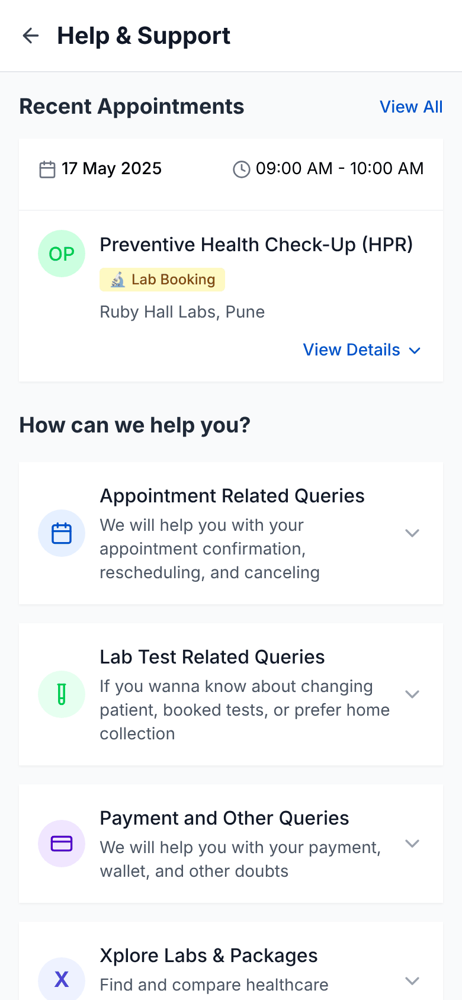
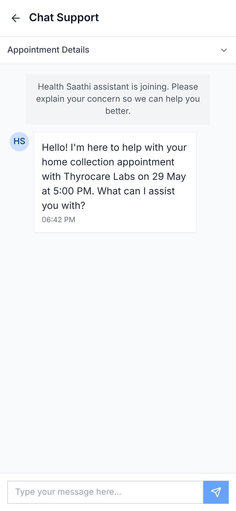
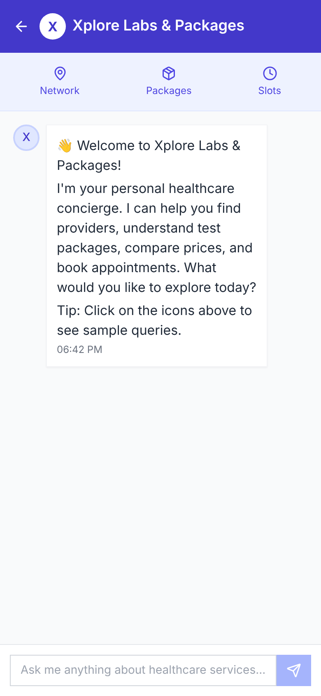
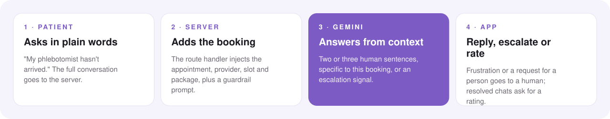

<div align="center">



<br/>

[](https://www.omkarpatil.in/#health-saathi)


**[The problem](#01--the-problem)** ·
**[v0 to v1](#02--what-v1-does-differently)** ·
**[The product](#03--the-product)** ·
**[How it works](#04--how-it-works)** ·
**[Where it stands](#05--where-it-stands)** ·
**[Run it](#07--run-it-yourself)**

</div>

---

> **A prototype.** Booking and provider data are sample fixtures standing in for a real booking API. The answers come from a real model (Gemini 2.5 Flash).

---

## 01 · The problem

Most support tickets for lab-test bookings come down to the same few questions: *Where's my phlebotomist? Can I reschedule? Do I need to fast? When will my report arrive?* Scripted chatbots can't answer them because they don't know **this customer's booking**, so the tickets land with human agents. That's slow for the patient and expensive for the business.

## 02 · What v1 does differently

This is the second version of Health Saathi. [v0](https://github.com/omkarpatilswork/v0-customer-support-chatbot) was a scripted decision-tree bot built to get the journey right. v1 replaces the scripts with an **LLM grounded in the booking**.

| | v0 (scripted) | **v1 (this repo)** |
|---|---|---|
| **Answers** | Canned replies per menu option | Free-text answers grounded in booking data |
| **Context** | None | Appointment, provider, slot, phlebotomist, package, fasting rules and report time |
| **Escalation** | A fixed "senior agent joining" step | **Detects frustration** or a request for a person, and escalates |
| **Discovery** | None | **Xplore**: compare labs, packages and slots by pincode |

## 03 · The product

<table>
<tr>
<td width="33%"><br/><sub><b>Help & Support.</b> Recent appointments, query categories and the way into Xplore.</sub></td>
<td width="33%"><br/><sub><b>Appointment chat.</b> The agent opens with this booking's lab, slot and visit type.</sub></td>
<td width="33%"><br/><sub><b>Xplore.</b> Labs, packages and slots compared for your pincode.</sub></td>
</tr>
</table>

<details open>
<summary><b>Appointment support agent</b></summary>
<br/>

- Grounded in the live booking: lab, collection type, slot, assigned phlebotomist, payment and report time
- Knows the package in detail, for example a 136-test full-body panel: what's included, fasting (8–12 hours) and preparation
- Shares a Google Maps link when asked for directions, and the phlebotomist's contact when they're late
- Short, human replies (two or three sentences) that end by checking whether anything else is needed
- **Escalation detection:** frustration or a request for a person moves the chat to the escalation path
- A **CSAT rating** at the end of each conversation
</details>

<details>
<summary><b>Xplore Labs & Packages</b></summary>
<br/>

A healthcare concierge that recommends providers, packages and available slots for the user's pincode and needs. It compares ratings, review counts, specialties, and home collection against a lab visit.
</details>

<details>
<summary><b>Self-serve flows</b></summary>
<br/>

- Cancel, with the reason captured and a warning about cancellation charges
- Reschedule with slot selection
- FAQs grouped into appointment, lab-test and payment questions
</details>

## 04 · How it works

<div align="center">

</div>

- **The key stays on the server.** Calls to Gemini go through Next.js route handlers ([`app/api/chat`](app/api/chat) and [`app/api/xplore`](app/api/xplore)); the browser never sees `GEMINI_API_KEY`.
- **Context in the prompt, not fine-tuning.** The booking and provider data are injected into each request, which keeps answers specific without training anything.
- **Tone is set in the system prompt:** human, concise and empathetic, with minimal emoji.

| Layer | What's used |
|---|---|
| **App** | Next.js 15 (App Router, route handlers), React 19, TypeScript, React Context for chat state |
| **Model** | Google Gemini 2.5 Flash |
| **UI** | Tailwind CSS, shadcn/ui |

## 05 · Where it stands

|  |  |
|---|---|
| **Status** | Working prototype. Written up as a case study at [omkarpatil.in/#health-saathi](https://www.omkarpatil.in/#health-saathi). |
| **Data** | Sample bookings and providers stand in for a real booking API. |
| **Actions** | The agent describes how to cancel or reschedule; the self-serve screens do it. The model itself can't take actions yet. |
| **Measurement** | No analytics yet. Containment, escalation rate and CSAT are the metrics this is designed to move. |
| **Built with** | Prototyped with v0, deployed on Vercel. |

## 06 · What's next

1. **Tool calls** so the agent can reschedule or cancel itself, not just explain how.
2. **Retrieval over real catalogues** of providers and packages, instead of prompt-injected fixtures.
3. **Dashboards** for containment rate, escalation rate and CSAT, to measure how many tickets it actually deflects.

## 07 · Run it yourself

You'll need Node 20+, pnpm and a Gemini API key.

```bash
git clone https://github.com/omkarpatilswork/Health-Saathi-AI-Agent-v1.git
cd Health-Saathi-AI-Agent-v1
pnpm install
echo "GEMINI_API_KEY=your_key_here" > .env.local
pnpm dev             # http://localhost:3000
```

## Repository map

```
Health-Saathi-AI-Agent-v1/
├── app/
│   ├── page.tsx            Help & Support
│   ├── chat/               the appointment chat
│   ├── project-x/          Xplore labs and packages
│   └── api/chat, api/xplore   server routes that call Gemini
├── utils/                  Gemini client, prompts and fixtures
├── context/                app and chat state
└── docs/                   screenshots and README diagram
```

---

<div align="center">
<sub>Built by <a href="https://www.omkarpatil.in">Omkar Patil</a>, product manager · v0 of this idea: <a href="https://github.com/omkarpatilswork/v0-customer-support-chatbot">v0-customer-support-chatbot</a></sub>
</div>
