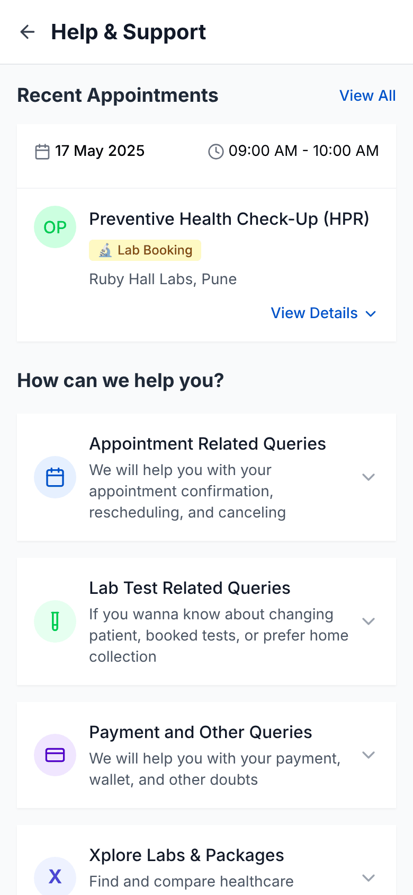
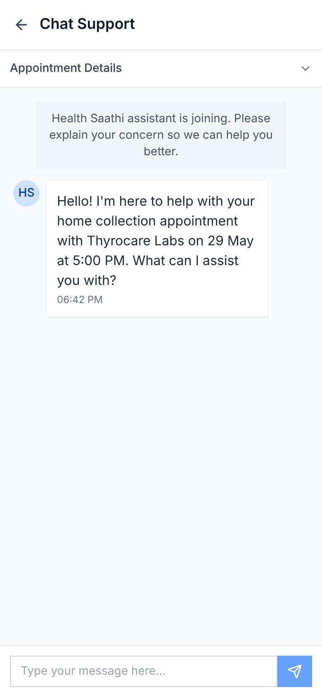
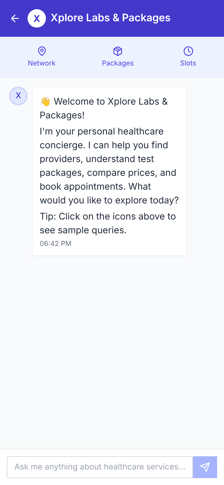
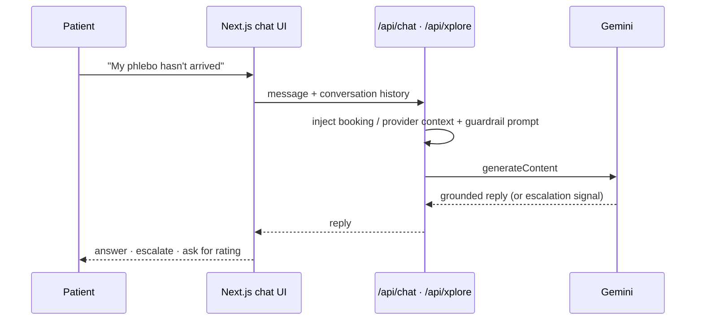

<div align="center">

# 🩺 Health Saathi: AI Support Agent (v1)

**An LLM support agent for diagnostic-lab bookings. It answers from the customer's actual appointment, knows when to hand over to a human, and helps people compare labs and packages.**


&nbsp;
&nbsp;


</div>

---

## The problem

In health-tech, most support tickets for lab bookings come down to the same few questions: *Where's my phlebotomist? Can I reschedule? Do I need to fast? When will my report arrive?* Scripted chatbots can't answer them because they don't know **this customer's booking**, so tickets end up with human agents. That's slow for the patient and expensive for the business.

## What v1 does differently

This is the second iteration of Health Saathi. [v0](https://github.com/omkarpatilswork/v0-customer-support-chatbot) was a scripted, decision-tree bot. v1 replaces the scripts with an **LLM grounded in the booking's context**.

| | v0 (scripted) | **v1 (this repo)** |
|---|---|---|
| Answers | Canned replies per menu option | Free-text answers grounded in booking data |
| Context | None | Appointment, provider, slot, agent, package, fasting rules and report time |
| Escalation | Fixed "senior agent joining" step | **Detects frustration** or a request for a human and escalates |
| Discovery | None | **Xplore**: compare labs, packages and slots by pincode |

## Features

### 💬 Appointment support agent
- Grounded on the live booking: lab, collection type, slot, assigned phlebotomist, payment and report time
- Knows the package in detail, for example a 136-test full-body panel: what's included, fasting requirements (8–12 hours) and preparation
- Sends a Google Maps link when asked for directions, and gives the agent's contact details when a technician is late
- Short, human-sounding replies (two or three sentences), closing with "anything else?" to confirm the question is resolved
- **Escalation detection**: frustration or a request for a human moves the chat to the escalation path
- **CSAT rating** at the end of each conversation

### 🔎 Xplore Labs & Packages
- A healthcare concierge that recommends **providers, packages and available slots** based on the user's pincode and needs
- Compares ratings, review counts, specialties, and home collection versus a lab visit

### 🗓️ Self-serve flows
- Cancel with reason capture (and a warning about cancellation charges)
- Reschedule with slot selection
- FAQs grouped by appointment, lab test, and payment queries

## How it works



- The API key stays on the server, in Next.js route handlers
- Context is passed in the prompt, which keeps the answers specific to the booking without fine-tuning
- The system prompt sets the tone: human, concise and empathetic, with minimal emoji

## Tech stack

Next.js 15 (App Router, Route Handlers) · React 19 · TypeScript · Google Gemini API · Tailwind CSS · shadcn/ui

## Run locally

```bash
git clone https://github.com/omkarpatilswork/Health-Saathi-AI-Agent-v1.git
cd Health-Saathi-AI-Agent-v1
pnpm install
echo "GEMINI_API_KEY=your_key_here" > .env.local
pnpm dev     # http://localhost:3000
```

> **Prototype note:** booking and provider data are sample fixtures standing in for a real booking API.

## What I'd build next

- Tool calls that perform actions (reschedule or cancel) instead of only describing them
- Retrieval over real provider and package catalogues instead of prompt-injected fixtures
- Containment rate, escalation rate and CSAT dashboards to measure deflection

---

Built by **[Omkar Patil](https://github.com/omkarpatilswork)**, Product Manager · Prototyped with v0 and deployed on Vercel.
